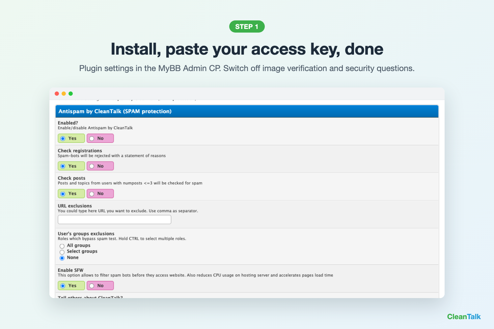
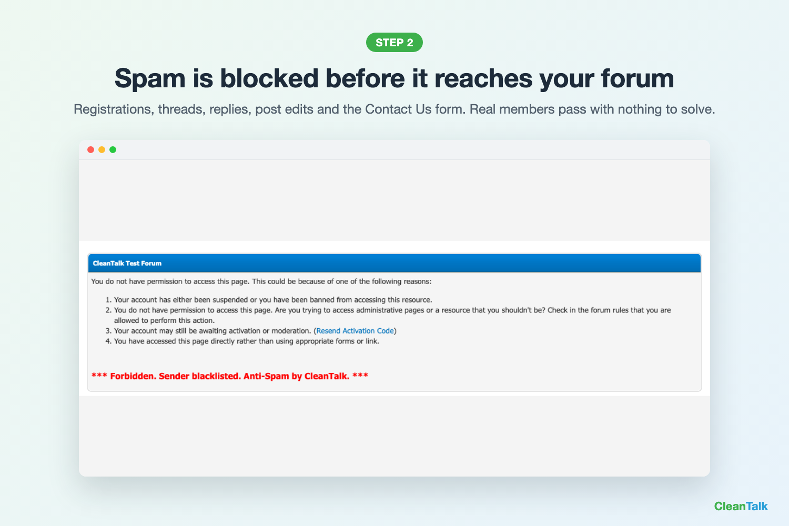

# Antispam by CleanTalk for MyBB

Spam protection for MyBB without CAPTCHA, image verification or security questions.
Blocks spam registrations, spam threads and replies, and Contact Us spam. Cloud anti-spam used on 1,100,000+ websites.

> **Free months for your review.** Post a review about CleanTalk on a community platform (for example, a MyBB forum thread), then send us the link from your [CleanTalk dashboard > Bonuses](https://cleantalk.org/my/bonuses). We add free months to your annual license.

## What it protects
- Registrations
- New threads and replies from new members
- Post edits
- Contact Us form
- SpamFireWall: blocks known spam bots before they load your pages

## Requirements
- MyBB 1.8.x (tested on 1.8.41, PHP 8.2)
- CleanTalk access key: [cleantalk.org/register](https://cleantalk.org/register?platform=mybb&utm_source=mybb&utm_medium=github), 7-day free trial, no card

## Install
1. Copy `antispam_by_cleantalk.php` and the `antispam_by_cleantalk` folder to `inc/plugins`
2. ACP > Configuration > Plugins > Antispam by CleanTalk > Install & Activate
3. ACP > Configuration > Settings > Antispam by CleanTalk: paste your access key

You can now switch off MyBB image verification and security questions: CleanTalk does the job invisibly.

## Free Anti-Spam & Security Licenses for Developers

We offer free Anti-Spam and Security licenses to developers who contribute to the development and maintenance of our plugins.

**How to qualify for free licenses:**
- Have at least one contribution to our plugins approved.
- Manage plugin, module, or extension releases and maintain their listings on relevant community platforms.

Interested? Contact us at [welcome@cleantalk.org](mailto:welcome@cleantalk.org) to claim your free licenses.

## Links
- [MyBB Mods page](https://community.mybb.com/mods.php?action=view&pid=1008)
- [CleanTalk dashboard](https://cleantalk.org/my)
- [Support](https://cleantalk.org/my/support)

If this plugin helps you, please star ⭐ the repository.
